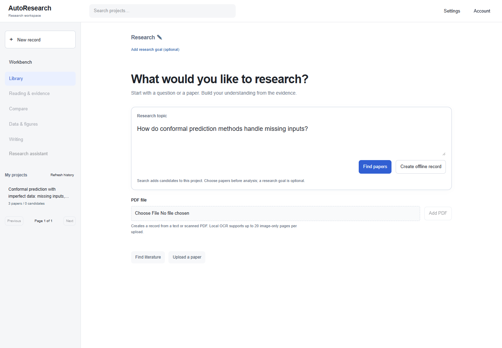
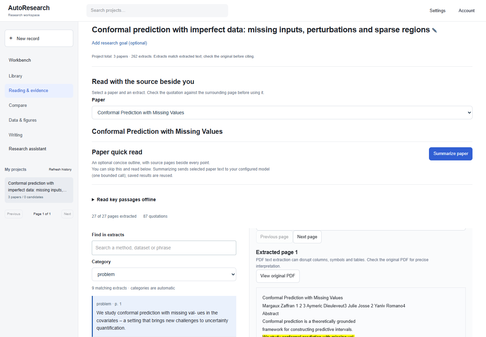
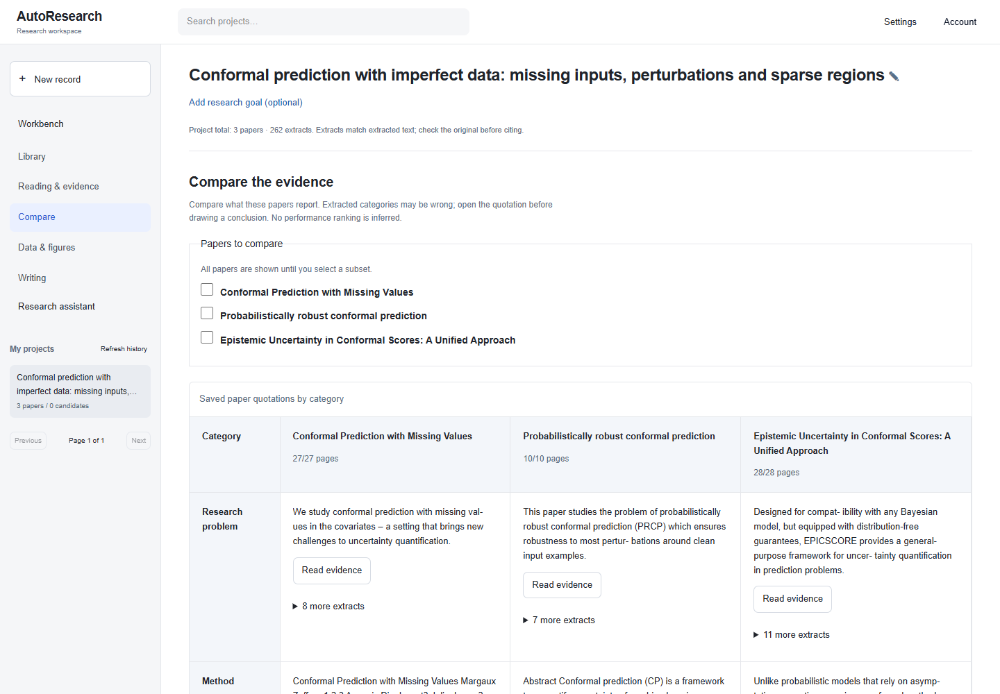
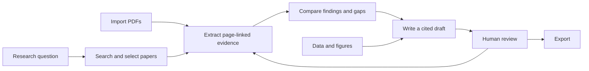

# AutoResearch-Agent

A local-first research workbench for turning a question and a collection of PDFs into a source-linked literature review. Compare what papers report, inspect the page behind a claim, and write with the evidence beside your draft.

[Try the public demo](https://github.com/zhengzhenghao007/AutoResearch-Agent/actions/workflows/video-study.yml) · [Read a generated draft](examples/conformal-prediction/outputs/draft.md) · [Quick start](#quick-start) · [中文使用指南](docs/local-quickstart.md)



## What you can do

| Workspace | Research task |
|---|---|
| **Library** | Start with a question, search for papers, or collect PDFs before deciding on a research goal. |
| **Reading & Evidence** | Inspect extracted quotations beside their source pages. Open the original PDF or request a model-assisted paper outline. |
| **Compare** | Compare methods, datasets, findings and limitations across papers. Follow an entry back to its evidence or flag a classification for review. |
| **Data & Figures** | Import CSV or JSON observations, inspect the data, and save tables, figures and experiment notes alongside the literature. |
| **Writing** | Draft with references open, insert cited material, save revisions and review the manuscript before export. |

## Inside the workbench

**Reading a paper.** Select an extract and inspect its surrounding page before using it in a draft.



**Comparing papers.** The comparison keeps source references alongside each entry and exposes gaps in the available evidence.



## Research workflow



You can enter any workspace as your project develops. For a bounded agent run, the research assistant can checkpoint a plan, build an evidence matrix, propose hypotheses and record unresolved questions. [Research task guide](docs/research-execution.md)

## Quick start

**Try a result first.** From a checkout, rebuild the video detection paper and its tables with Python 3.11 or 3.12. This example uses only the standard library.

```shell
python examples/video-detection/reproduce.py
```

**Run the workbench locally.** Install Python 3.11 or 3.12 and Node.js 20.9 or later. The default workflow runs without a model key.

```shell
git clone https://github.com/zhengzhenghao007/AutoResearch-Agent.git
cd AutoResearch-Agent
python -m venv .venv
```

Activate the environment with `source .venv/bin/activate` on macOS/Linux or `.\.venv\Scripts\Activate.ps1` in PowerShell. In that terminal, install the dependencies and start the API:

```shell
python -m pip install -r requirements.txt
npm --prefix frontend ci
python -m uvicorn backend.app.main:app --host 127.0.0.1 --port 8000 --no-proxy-headers
```

In a second terminal at the repository root, start the frontend:

```shell
npm --prefix frontend run dev -- --hostname 127.0.0.1 --port 3000
```

Open [the local workbench](http://127.0.0.1:3000), enter a question or add a PDF. To try a populated workspace, run `python examples/conformal-prediction/reproduce.py --install` in the activated environment and refresh project history. [Local setup guide](docs/local-quickstart.md) · [Authenticated deployment](docs/p5-deployment.md)

## Research in practice

### Can AI-generated videos be reliably detected?

In a reanalysis of published detector scores across five generators, D3 had the highest mean average precision (**86.328%**) but fell to **45.11%** on Text2Video-Zero. NPR achieved the highest minimum (**70.79%**). The study includes 23 verified paper records, five processed full texts, and code to recompute the measurements from the published table. [English paper](examples/video-detection/paper.md) · [Source table](examples/video-detection/experiment/published_table4.csv) · [Page-level evidence](examples/video-detection/literature/evidence.json) · [16-second walkthrough](examples/video-detection/case-walkthrough.mp4)

To run a fresh search in the installed research environment:

```shell
python examples/video-detection/live.py --query "AI-generated video detection"
```

A recorded run retrieved 60 metadata records, imported three papers and proposed six hypotheses. Its final report requests human review. The published manuscript draws on a separately curated corpus. [Live execution receipt](examples/video-detection/live-receipt.json) · [English tutorial](examples/video-detection/README.md)

### How does conformal prediction handle imperfect inputs?

The offline pipeline processed **three CC BY 4.0 papers**, covering **65 pages** and **262 source-linked quotations**, then generated a comparison and saved a draft. The accompanying audit identifies bibliography entries and misclassified passages that required editorial review. [Automatic draft](examples/conformal-prediction/outputs/draft.md) · [Citation registry](examples/conformal-prediction/outputs/citations.json) · [Error analysis](examples/conformal-prediction/audit.md)

## System architecture

| Layer | Role |
|---|---|
| [Frontend](frontend/) | Next.js and React workspaces for projects, reading, comparison, figures and writing. |
| [Backend API](backend/app/) | FastAPI endpoints for project records, uploads, research tasks and exports. |
| [Agents](agents/) and [pipelines](pipelines/) | Planner, reader and reviewer roles with a model-backed reading and review path. |
| [Workflows](workflow/) and [services](services/) | Coordinate ingestion, extraction, source checks, skill execution, task budgets and checkpoints. |
| [Schemas](schemas/) and [evaluation](evaluation/) | Define shared record contracts and exercise evidence checks against fixtures. |

[Architecture and data contracts](docs/architecture.md) · [Engineering guide](docs/engineering-guide.md) · [Audit of a real execution](docs/video-detection-architecture-audit.md)

## Known limits

- A quotation can match its page and still be misinterpreted. PDF column order, bibliography entries and OCR errors can affect extraction. Researchers review scientific claims and approve exports.
- The importer accepts PDFs up to 20 MiB and processes up to 50 pages by default. New imports retain the original PDF. Scanned pages use bounded local OCR. [PDF support](docs/scanned-pdf.md)
- Live searches depend on provider availability. Model-assisted reading requires configuration and can incur provider charges. Experimental findings in the video case come from published observations.

## Roadmap

Current priorities include improving evidence classification, evaluating semantic support and contradictions, and measuring review quality against human judgments. The roadmap records delivered work and open tasks. [Development roadmap](docs/roadmap.md)

## Contributing

Pick a reproducible problem or an open roadmap item. For a citation issue, include the paper identifier, page and affected claim. For a code change, describe the user-visible behavior and include the relevant test or reproduction command in your pull request.

With the virtual environment active and frontend dependencies installed:

```shell
python -m pip install -r requirements-ci.txt
python -m pytest tests -q
npm --prefix frontend test
```

[Open an issue](https://github.com/zhengzhenghao007/AutoResearch-Agent/issues) · [Test and development reference](docs/engineering-guide.md)
