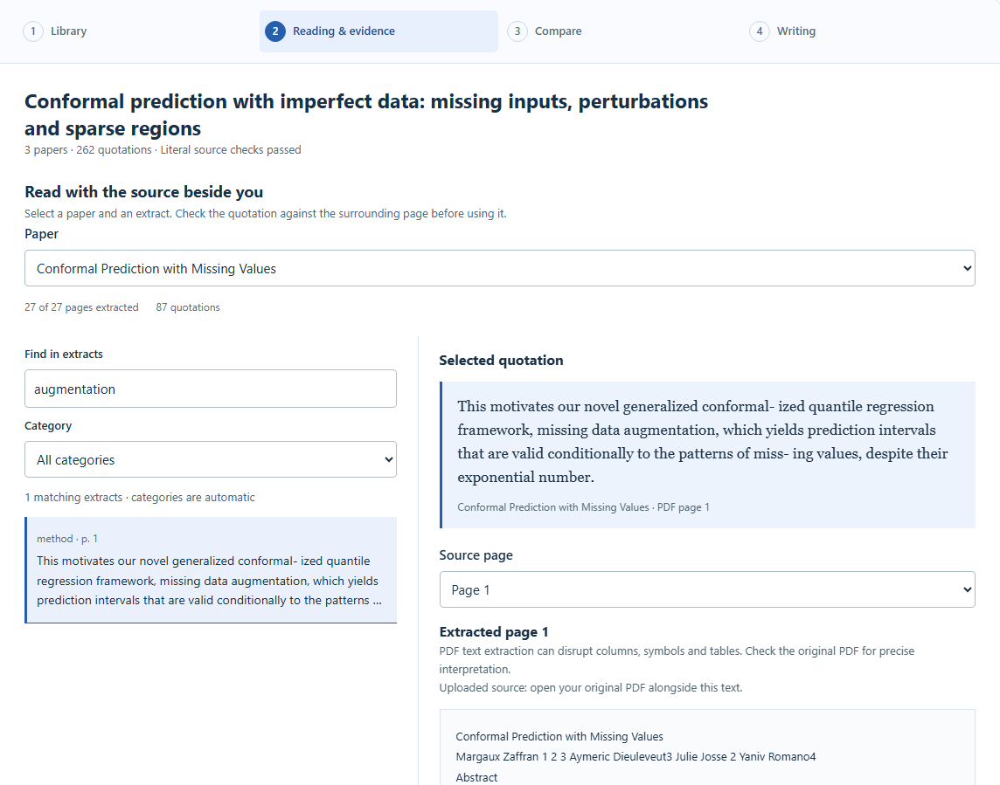
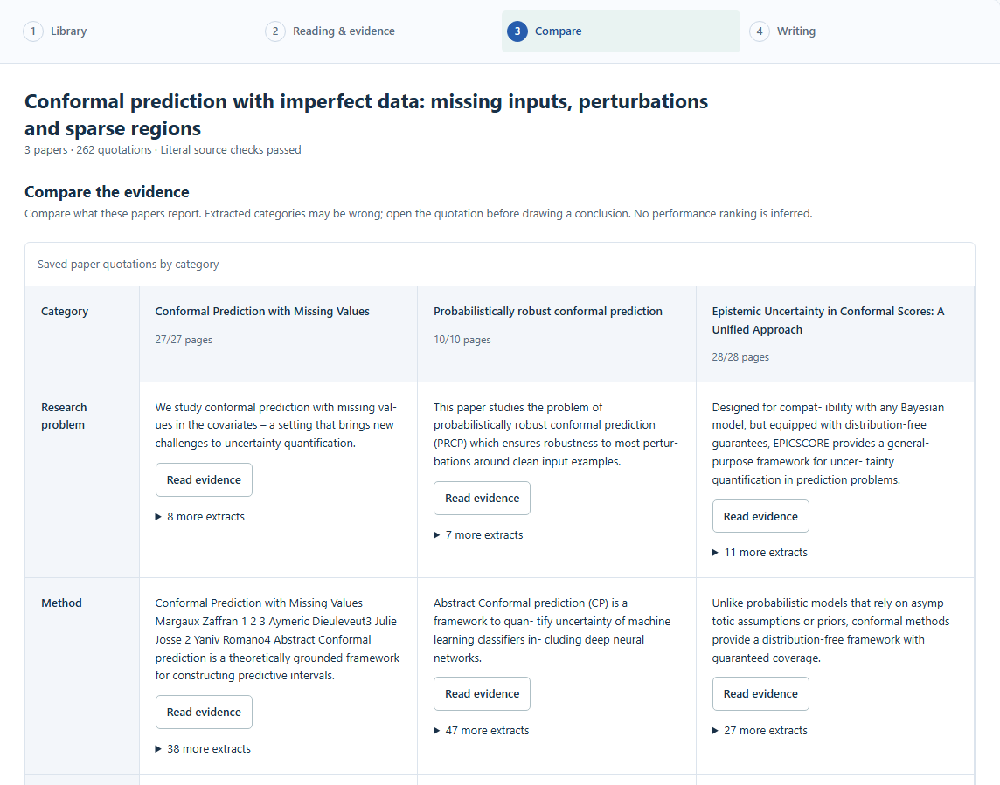

# AutoResearch-Agent

**A traceable literature research workbench.**

可追溯的文献研究工作台：整理文献、核对原文、比较证据，再形成有出处的草稿。

Bring a research question and a small collection of papers. Keep quotations attached to their source pages, compare what the papers report, and develop a draft without losing its evidence. Records and revisions stay on your machine in default local mode.



[Explore the complete example](examples/conformal-prediction/README.md) · [中文使用指南](docs/local-quickstart.md) · [Engineering reference](docs/engineering-guide.md)

## One record, four places to work

| Workspace | What you do |
|---|---|
| **Library** | Search arXiv, choose candidates or import PDFs. Reopen saved research from history. |
| **Reading & evidence** | Select a paper, search its extracts, and inspect a quotation beside its extracted page. |
| **Compare** | Compare categories across papers. Follow extracts back to evidence; missing material stays visible. |
| **Writing** | Assemble an attributed outline, edit and save revisions, then explicitly review and approve an export. |

Advanced source checks, screening records and category corrections are available when needed. Local mode opens without a token prompt. The older interface lives separately at `/legacy`.

The Library overview highlights truncated papers, missing extraction categories and sources without quotations, with links to inspect each one. Workflow links retain your current stage on reload. Unsaved manuscript changes block record/session switches and trigger the browser's close warning; save a revision before closing, or explicitly discard edits. Browser crash recovery is not provided.

See the [public-product comparison and quality review](docs/superpowers/plans/2026-10-27-workbench-quality.md) for the design references, verified improvements and remaining limits.

## A real example, including what went wrong

**How do conformal prediction methods address missing inputs, perturbations and sparse training regions?**

The [worked case](examples/conformal-prediction/README.md) processes three CC BY 4.0 papers through the actual offline pipeline: **65 PDF pages, 262 source-linked quotations, a comparison and a saved manuscript revision**. The corpus is deliberately selected; it is not a systematic review.



- [Read the short editorial comparison](examples/conformal-prediction/review-notes.md), separated from automatic output.
- Inspect the [actual automatic draft](examples/conformal-prediction/outputs/draft.md) and [citation registry](examples/conformal-prediction/outputs/citations.json).
- Check the [omissions and errors](examples/conformal-prediction/audit.md): misclassified sentences, bibliography noise, missed abstract statements and an oversized PDF rejection.
- Reproduce using [pinned publisher PDFs and licenses](examples/conformal-prediction/sources.json), or install the checked-in record without downloads.

Every saved quote matches its extracted page. **That is traceability, not proof of correct interpretation.** The example has no fabricated experiments, model calls or human approval. Its final writing artifact is a review draft.

## Quick start

Requires **Python 3.11+ and Node.js 20.9+**. Run from the repository root. No model key is needed for the default workflow.

```powershell
git clone https://github.com/zhengzhenghao007/AutoResearch-Agent.git
cd AutoResearch-Agent
python -m venv .venv
.\.venv\Scripts\python.exe -m pip install -r requirements.txt
npm --prefix frontend ci

# Optional: install the real example as a new local research record.
.\.venv\Scripts\python.exe examples/conformal-prediction/reproduce.py --install

# Terminal 1: local API, no credentials or paid model calls.
$env:PYTHON_DOTENV_DISABLED='1'
$env:AUTORESEARCH_DEPLOYMENT='0'
$env:AUTORESEARCH_STORAGE='json'
.\.venv\Scripts\python.exe -m uvicorn backend.app.main:app --host 127.0.0.1 --port 8000 --no-proxy-headers
```

In a second terminal, from the same repository root:

```powershell
npm --prefix frontend run dev -- --hostname 127.0.0.1 --port 3000
```

Open **http://127.0.0.1:3000**. Choose the example in **Your research**, or add your own text-based PDF in **Library**. Start with **Reading & evidence**, then **Compare** and **Writing**. Search requires internet; imported PDFs and the installed example work offline.

For macOS/Linux, use `.venv/bin/python` and `export NAME=value` instead of PowerShell environment syntax. See the [detailed startup guide](docs/local-quickstart.md) for configuration and operation. Keep default local mode on loopback; shared hosting uses the separate [authenticated deployment setup](docs/p5-deployment.md).

## Current boundaries

Rule extraction is reproducible and requires no model, but can miss statements, mix PDF columns and misclassify quotations. There is no OCR; the importer accepts text PDFs up to 20 MiB and parses at most 50 pages by default. Comparisons do not rank incompatible experiments. The tool does not autonomously run experiments or establish novelty, causality or scientific validity. Human scientific evaluation remains incomplete; the example is not a replacement for it.

Optional model-based review is explicit and may incur provider costs. See [data and deployment boundaries](docs/p5-deployment.md) before sharing an instance.

## For contributors

- [Architecture and data contracts](docs/architecture.md)
- [API, CLI, testing and capability reference](docs/engineering-guide.md)
- [Roadmap](docs/roadmap.md)
- [Case reproduction and licensing](examples/conformal-prediction/README.md)

```powershell
.\.venv\Scripts\python.exe -m pip install -r requirements-ci.txt
.\.venv\Scripts\python.exe -m pytest tests -q --allow-hosts=127.0.0.1,::1
npm --prefix frontend test
npm --prefix frontend run lint
npm --prefix frontend run build
```

Engineering checks test behavior and provenance contracts. They do not measure the scientific quality of a literature review.
