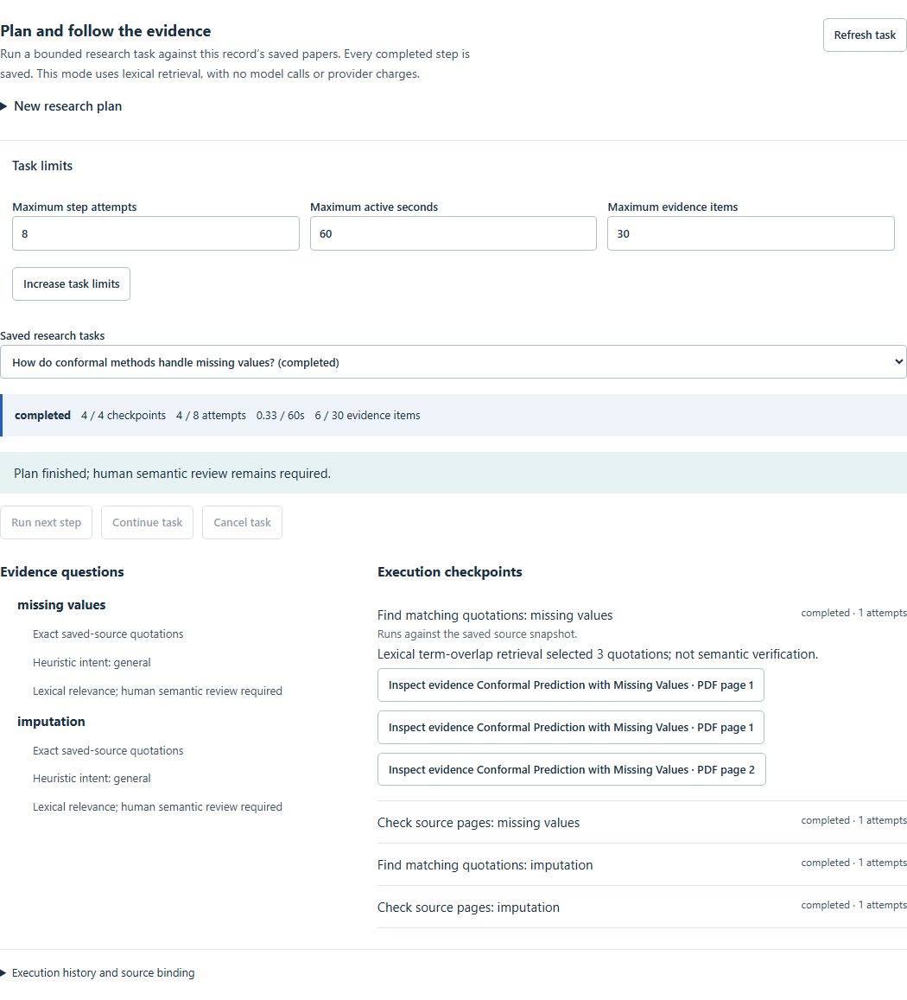

# 可恢复的论文研究任务

这一执行模式在**当前研究记录已保存的论文**中查找证据，默认离线。它不是开放网络自主搜索，也不会调用模型、运行论文代码或替研究者批准结论。

## 使用流程

1. 打开一个有论文的记录，在 Library 展开 **Research tasks: plan, checkpoints and budget**。
2. 填写研究问题；可按行填写最多六个明确子问题。留空时使用可检查的启发式计划，不能视为模型对领域的理解。
3. 设置步数、活跃执行秒数和证据条目预算，创建计划。创建后先检查子问题、证据要求和依赖；不会自动执行。
4. **Run next step** 执行一个步骤，**Continue task** 连续请求步骤，直到停止、遇到错误或达到预算。**Pause after this step** 在当前步骤保存后停止发起新请求；不是强制中断已发出的请求。
5. 关闭后重新打开记录、选择保存的任务，即可检查并继续。已完成检查点不会重复执行。结果中的 **Inspect evidence** 会重新检查来源状态，再打开阅读区。
6. 预算不足时，显式 **Increase task limits** 后继续。预算只能增加，已使用的额度不会清零。失败请求需先刷新任务，避免把未知提交状态当作未执行。

## 持久化与恢复

任务保存在研究存储目录下的 `research_tasks.sqlite3`，独立于文稿版本。部署模式继承现有用户隔离；只读用户可以查看任务，但不能创建、执行、取消或增加预算。备份研究记录时也应备份这个数据库；恢复时保持对应记录和来源一致。

执行器通过事务领取步骤、记录尝试和时间预留，再运行受限只读工具。结果提交时重新检查所有者、取消状态和来源哈希。崩溃遗留的领取状态在租约过期后可回收；时间预留按保守规则计入消耗，而不是通过重启重置预算。取消或来源变化后的迟到结果不得提交。

当前可执行工具只有词面检索与来源检查，没有任意代码、外部写入或付费工具。因此恢复只涉及纯读取重试。未来增加付费或有副作用的工具之前，仍需实现对应的幂等提交协议；当前机制不代表已经验证了这类工具的恰好一次执行。

## 预算的含义

- **步数**是已领取的步骤尝试次数，包括因中断而重试的尝试。
- **活跃秒数**用于限定工具步骤的运行与恢复预留，不是从创建到现在的日历时间。
- **证据条目**限制检索步骤选入的条目数量；不是全语料覆盖保证。
- 模型输入/输出 token 与提供商费用为 **0**，因为此模式没有模型调用。它不估算本机电费、CPU 或存储成本。

`completed` 仅表示既定检索/检查步骤完成，不等于子问题已获得科学上充分的答案。`incomplete`、`budget_exhausted`、`stale` 等状态保留原因和已有检查点。任何词面匹配、来源一致或哈希一致都不能替代语义判断。

## 真实资料评测

见 [真实论文执行评测](../examples/research-execution/README.md)。评测使用已有 CC BY 4.0 三篇论文，比较固定类别基线与任务执行器，保存原始选择、遗漏、重复运行结果、实测时间及来源哈希。包含无答案查询和参考文献词面误命中。

自动指标限定为原文绑定与词面覆盖代理。专家语义支持、比较合理性及科学正确性保留为未审核；不能把这些空值当作 100% 或把软件测试视为真实研究验收。

## API

在 `/api/research/runs/{run_id}/tasks` 上 GET 列表、POST 创建；使用 `/{task_id}` GET 任务，POST `/{task_id}/next` 执行一步，POST `/{task_id}/cancel` 取消，POST `/{task_id}/budget` 显式增加预算。请求体、来源绑定与响应由 `schemas/research_tasks.py` 定义。
