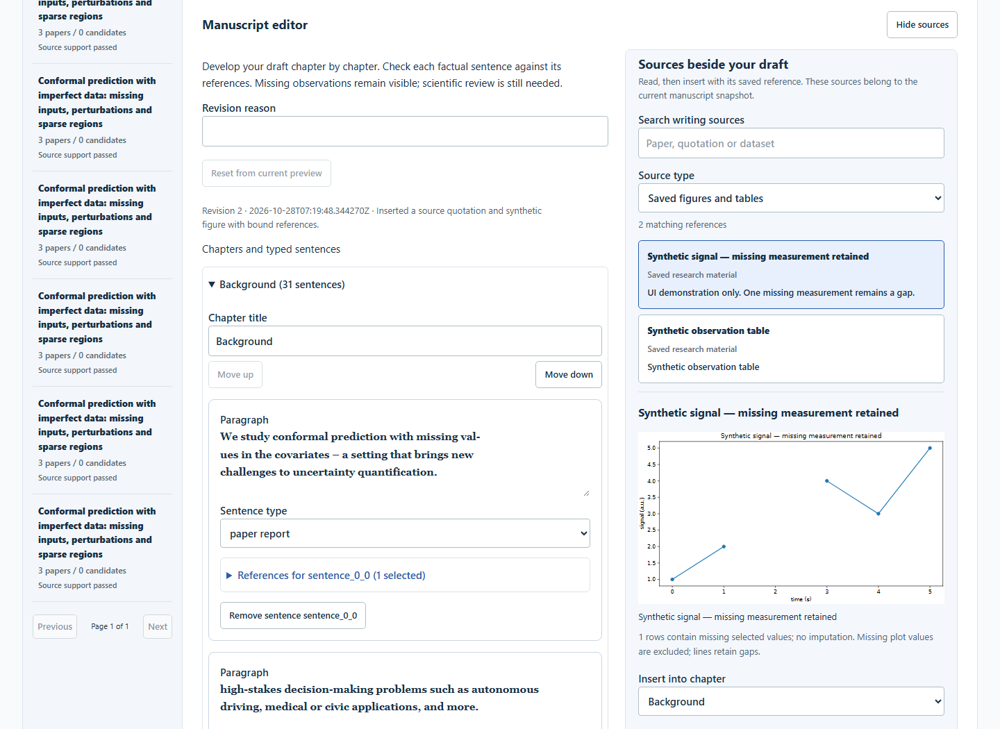
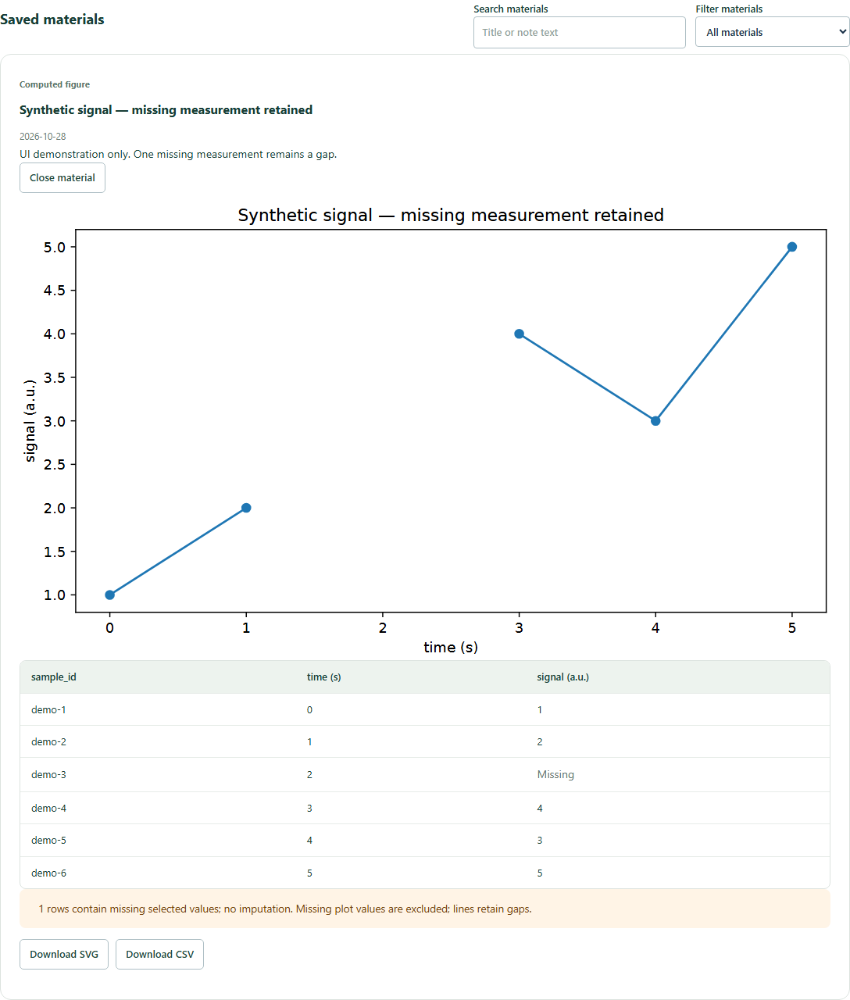

# Research studio guide

The studio keeps literature, observations, saved materials and manuscript revisions in one research record. Default local mode stores these records locally. It does not run autonomous experiments or certify research conclusions.

## Work across five stages

| Stage | Purpose |
|---|---|
| Library | Search for papers, select candidates, import text PDFs and reopen records. |
| Reading & evidence | Inspect extracted page text and quotations attached to source pages. |
| Compare | Compare paper reports by category and see missing coverage. |
| Data & figures | Import observations, inspect raw rows, preview/save figures or tables, and write experiment notes. |
| Writing | Edit manuscript chapters while keeping searchable reference material alongside them. |

Sources in the writing panel scroll separately from the document on wide screens. The layout stacks on narrow screens. Source search/filter and a target chapter help insert referenced content without copying identifiers manually. Saved figures and tables retain their material binding and caption; notes are kept as researcher records rather than automatically promoted to scientific results.

## From observations to a saved material

1. Open or create a research record, then choose **Data & figures**.
2. Import JSON with metadata, or choose CSV and supply a dataset title and ordered `name=unit` column declarations. Empty numeric cells are missing observations. See the [synthetic walkthrough](../examples/research-studio/README.md) or [complete import contract](p3-observations.md).
3. Select the dataset to inspect raw observations. Readers can browse datasets; saving requires write access. The visible table shows at most 50 rows.
4. Choose **Data table** or **Computed figure**, provide a title, select columns, and add an optional caption. A figure has one Y column. Line and scatter figures require a numeric X column; bars may use sample identifiers.
5. Select **Preview material**. Inspect the table/chart and warnings before saving. Changing the specification invalidates the previous preview. The server binds the rendering to the dataset hash and selected specification.
6. Select **Save material**. Reopen it from **Saved materials**, using title/note search or the kind filter. Rendering loads on an explicit open. CSV downloads include the full rendered table even when the visible preview is capped; SVG downloads preserve the figure.

Use **Researcher note** for a titled experiment record, optionally linked to a dataset. Notes save without a chart preview. Saved materials are append-only: corrections create new records. Failed saves retain the material draft. Save or explicitly discard pending text before leaving; browser crash recovery is not provided.

Missing observations are not replaced with zero. Line renderings do not interpolate across missing observations. Charts do not add significance tests or invented uncertainty. Exported CSV text cells are neutralized against spreadsheet formula interpretation; numeric values remain numeric text.

The screenshots use isolated test records and explicitly synthetic observations; they do not show scientific results from the cited papers.

## Write with evidence beside the document

Open **Writing** and create/open the manuscript revision. Use **Show sources** if the source panel is hidden. Inspect quotations and page references, search or filter reference blocks, select a target chapter, and insert the appropriate supported material. Review the inserted paragraph and its references before saving a revision.

References belong to the revision's source snapshot. If source data changes, the editor reports a stale snapshot; refresh/reset from the current preview and reconcile the manuscript before approval/export. Saved visual assets preserve their captions and identity. They cannot be reinterpreted as arbitrary free-text evidence by editing the caption in place.

Manuscript review with the configured model is an explicit action with consent and may incur cost. Human approval is tied to the exact revision. The approved bundle export contains `manuscript.md`, `references.json`, `provenance.json`, and SVG files under `assets/` for included figures. Markdown-only export remains available. A saved material download alone is not manuscript approval.

## Boundaries

- Imported PDF binaries are **not retained**. The reading view contains extracted page text, not an original PDF viewer. Keep your source PDFs separately.
- Observation import supports CSV and JSON, not XLSX. Numeric columns and explicit metadata follow the existing bounded import contract.
- Materials and their search belong to one research record; there is no cross-project material search.
- Parsed quotations, hashes, deterministic renderings and source-linked exports support traceability. They do not establish experimental authenticity, correct interpretation, causal inference or scientific validity.
- There is no autonomous scientific validation. Researcher judgment and independent scientific evaluation remain necessary.

## Design and evaluation references

These sources informed workflow and evaluation priorities. They are not integrations, endorsements, or evidence that this project reaches their reported performance.

- [Systematic Reviews in Elicit](https://support.elicit.com/en/articles/14759154-systematic-reviews-in-elicit) describes a staged workflow from gathering and screening through extraction and reporting. It inspires visible stages and explicit transitions here; this studio does not claim to implement Elicit's complete systematic-review process.
- [DeepResearch Bench II: Diagnosing Deep Research Agents via Rubrics from Expert Reports](https://arxiv.org/abs/2601.08536) motivates separating information coverage, analysis and presentation in evaluation. This project has not been scored on that benchmark.
- [How Far Are We from Genuinely Useful Deep Research Agents?](https://arxiv.org/abs/2512.01948) presents FINDER and a failure taxonomy involving retrieval, reasoning and generation. It motivates checking evidence integration and verification separately from interface usability. No benchmark results are claimed here.

Engineering tests check persistence, source bindings, validation, UI behavior and export gates. A polished interface and passing tests are not a scientific-quality evaluation.
