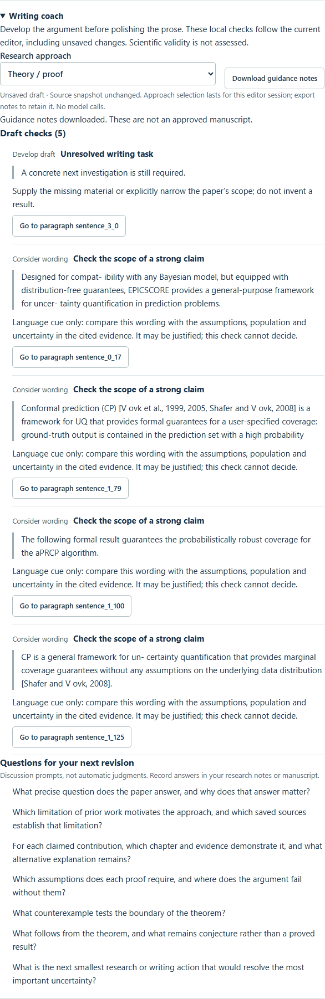

# 论文指导：从论证到修改

在 Writing 的 Manuscript editor 中展开 **Writing coach**。面板读取当前编辑器内容，因此未保存的改动也会立即影响检查结果；不会调用模型、改写正文、记录人工批准或花费提供商费用。

## 如何使用

1. 选择研究方式：实证/实验、理论/证明、综述/综合，或解释/质性研究。默认不猜测类型。
2. 先处理 **Repair binding**：没有引用、引用已缺失或不唯一、段落和材料类型不符、来源版本变化。
3. 再处理 **Develop draft**：空章节和仍标为 placeholder 的内容。使用 **Go to paragraph** 展开对应章节并定位输入框；正文保持原样。
4. **Consider wording** 只提示限定的中英文强措辞，不自动认定过度声称。例如某个定理确实可以证明保证，仍应由作者核查其假设与范围。
5. 用下面的追问梳理研究问题、文献缺口、贡献与证据之间的关系。理论类追问证明条件与反例；综述类追问纳入标准与文献分歧；不把所有论文都套入基线实验模板。
6. **Download guidance notes** 导出 JSON 工作笔记，包含研究记录、基础文稿版本、来源快照、未保存/来源变化标志、问题定位及讨论问题。研究方式选择仅保留在当前编辑器会话；导出的笔记可以留档，回答可保存在现有研究笔记或正文中。

没有机械问题不等于论证正确、具有创新性或可以投稿。引用 ID 存在只说明绑定可找到，不能验证语义支持。指导笔记不是人工批准的论文导出，也不会伪造指导教师身份。当前不提供持久问答、多轮导师记忆、自动实验设计或自动科研质量评分。

## 公开设计参考（2026-11-03 查阅）

- [HKUSTDial/Supervisor-Skills](https://github.com/HKUSTDial/Supervisor-Skills)：参考先规划论证、按研究范式指导、再给行动建议的组织方式。
- [技术论文结构 skill](https://github.com/HKUSTDial/Supervisor-Skills/blob/main/skills/tech-paper-template/SKILL.md)：帮助确定写作前应检查的问题与贡献关系。
- [投稿前审查 skill](https://github.com/HKUSTDial/Supervisor-Skills/blob/main/skills/pre-submission-reviewer/SKILL.md)：参考区分问题优先级及学科范式的思路。
- [Academic Researcher](https://github.com/Scottthe3rd/academic-researcher-skill)：参考指导、审阅、阅读记录和下一步行动的不同职责。

这里是针对本项目已有证据类型和文稿版本实现的原创代码与提示，不安装或复制第三方 skill，也没有集成其全部能力。上游仓库与不同文件的许可标注存在差异；今后若复用其正文或代码，需要逐项核对对应版本及许可。
