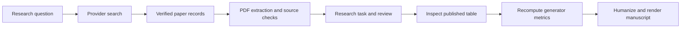

# Can AI-generated videos be reliably detected?

Read the [English paper](paper.md), inspect its [source observations](experiment/published_table4.csv), or watch the [16-second results walkthrough](case-walkthrough.mp4). On five generators D3 had the highest mean AP, yet on Text2Video-Zero it scored 45.11%. NPR had the strongest observed minimum, 70.79%.

## Reproduce the result

From the repository root with its Python environment activated:

```shell
python examples/video-detection/reproduce.py
```

On a fresh checkout, install the project dependencies with `python -m pip install -r requirements.txt` first. Replay reads the frozen observations, checks the conference PDF identity against the native receipt, recalculates every result, validates evidence locators, and writes the English manuscript and research directions after running Academic Humanizer. It runs offline. To ask your own question, start the [workbench](../../docs/local-quickstart.md) and enter your research topic. This replay script reproduces the named study.



| Inspect | Artifact |
|---|---|
| Search parameters, rate limit, screening and metadata | [Literature inventory](literature/README.md) |
| Ten source notes with page anchors and limitations | [Evidence](literature/evidence.json) |
| Three proposed directions and the selection rationale | [Research gaps](research-gaps.md) |
| Experimental design, baseline implementations, dataset and license | [Methods](experiment/methods.md) |
| Input cells, program and outputs | [Table 4](experiment/published_table4.csv) · [Analysis](experiment/analyze.py) · [Results](experiment/results.json) |
| Six native skill executions, budgets, source digests and coverage gaps | [Execution receipt](workflow/run.json) |
| Humanizer integration, calls and semantic errors | [Architecture and test report](../../docs/video-detection-architecture-audit.md) |

## How much was autonomous?

The application executed searches, PDF extraction, literal checks, matrix construction, hypothesis suggestions, draft synthesis and supervision. Codex supplemented retrieval with targeted searches, screened primary records, chose the empirical question, inspected source tables and prepared the manuscript renderer. An offline replay regenerates that study from its evidence. The app still needs scientific supervision to turn an arbitrary topic into a defensible paper.

The native run processed five PDFs and 47 pages, found 327 candidate spans and selected 30 for the task budget. Three inspected spans had incorrect semantic labels. The paper uses page-checked source notes and attributed measurements. No new detector was trained or run on individual clips. Calibration and real-world false-positive rates remain open. To repeat live retrieval or PDF processing, follow the literature instructions and the architecture report. Changed provider rankings, rate limits and PDF versions may produce different results.
