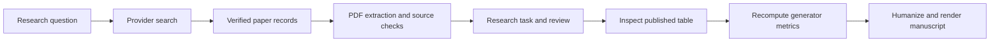

# Can AI-generated videos be reliably detected?

Read the [English paper](paper.md), inspect its [source observations](experiment/published_table4.csv), or watch the [16-second results walkthrough](case-walkthrough.mp4). On five generators D3 had the highest mean AP, yet on Text2Video-Zero it scored 45.11%. NPR had the strongest observed minimum, 70.79%.

## Reproduce the result

For a browser-only replay, open the [GitHub Actions example](https://github.com/zhengzhenghao007/AutoResearch-Agent/actions/workflows/video-study.yml). Open a successful run to see its log. Signed-in users can download the study artifact. To launch your own run, fork the project, enable Actions, and choose **Run workflow** in your fork.

Alternatively, run this from the repository root with Python 3.11 or 3.12:

```shell
python examples/video-detection/reproduce.py
```

The frozen example uses the Python standard library. Replay reads the frozen observations, checks the conference PDF identity against the native receipt, recalculates every result, validates evidence locators, and writes the English manuscript and research directions after running Academic Humanizer. It runs offline. To ask your own question, start the [workbench](../../docs/local-quickstart.md) and enter your research topic. This replay script reproduces the named study.

## Start a fresh research task

Activate the project environment and install its dependencies. Run the following command to search current literature, rank candidates, acquire PDFs, execute the six research skills and write a source-linked report.

```shell
python examples/video-detection/live.py --query "AI-generated video detection"
```

The command prints a unique local output directory. Open `report.md` for the generated hypotheses, evidence matrix, synthesis and unresolved gaps. Inspect `search.json`, `screening.json` and `task.json` for the intermediate decisions. Candidates are ranked by distinct query terms in the title, then provider rank. The runner attempts at most five canonical arXiv downloads and imports up to three readable PDFs. A run with no readable sources exits with an error and retains the search record. Provider availability and rankings can change. [Receipt from a fresh execution](live-receipt.json)



| Inspect | Artifact |
|---|---|
| Search parameters, rate limit, screening and metadata | [Literature inventory](literature/README.md) |
| Ten source notes with page anchors and limitations | [Evidence](literature/evidence.json) |
| Three proposed directions and the selection rationale | [Research gaps](research-gaps.md) |
| Experimental design, baseline implementations, dataset and license | [Methods](experiment/methods.md) |
| Input cells, program and outputs | [Table 4](experiment/published_table4.csv) · [Analysis](experiment/analyze.py) · [Results](experiment/results.json) |
| Six native skill executions, budgets, source digests and coverage gaps | [Execution receipt](workflow/run.json) |
| Humanizer integration, calls and semantic errors | [Architecture and test report](../../docs/video-detection-architecture-audit.md) |

## How much was autonomous?

The application executed searches, PDF extraction, literal checks, matrix construction, hypothesis suggestions, draft synthesis and supervision. Codex supplemented retrieval with targeted searches, screened primary records, chose the empirical question, inspected source tables and prepared the manuscript renderer. An offline replay regenerates that study from its evidence. The app still needs scientific supervision to turn an arbitrary topic into a defensible paper.

The native run processed five PDFs and 47 pages, found 327 candidate spans and selected 30 for the task budget. Three inspected spans had incorrect semantic labels. The paper uses page-checked source notes and attributed measurements. No new detector was trained or run on individual clips. Calibration and real-world false-positive rates remain open. To repeat live retrieval or PDF processing, follow the literature instructions and the architecture report. Changed provider rankings, rate limits and PDF versions may produce different results.
